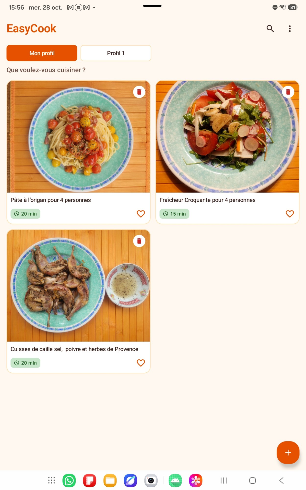
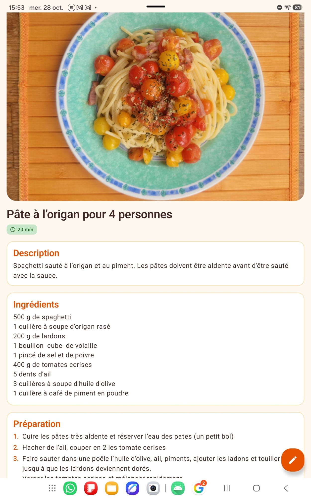

# EasyCook

Application Android de gestion de recettes de cuisine, écrite en Kotlin avec Jetpack Compose.
Elle permet de créer ses propres recettes, de les consulter et de les suivre étape par étape en cuisinant.

## Aperçu

<p align="center">
  
  &nbsp;&nbsp;
  
</p>
<p align="center"><em>L'accueil et le détail d'une recette</em></p>

## Fonctionnalités

- **Liste des recettes** : grille de cartes (2 colonnes en portrait, 3 en paysage), avec le temps de cuisson et la suppression après confirmation.
- **Favoris** : le cœur d'une carte met la recette en favori ; les favoris sont affichés en premier.
- **Recherche** : la loupe de l'accueil filtre les recettes au fil de la saisie (titre, ingrédients, description), en ignorant majuscules et accents, et classe les résultats par pertinence.
- **Profils importés** : des onglets au-dessus de la liste (« Mon profil », puis « Profil 1 », « Profil 2 »…) séparent tes recettes de celles reçues d'autres téléphones. Chaque import crée un nouveau profil, dont les recettes se gèrent comme les tiennes ; un profil importé peut être supprimé avec toutes ses recettes.
- **Partage par QR code** : menu « ⋮ » → « Partager par QR code ». On coche les recettes à envoyer (ou « Tout sélectionner »), puis l'écran affiche un QR code. Sur l'autre téléphone, « Recevoir (scanner un QR code) » télécharge les recettes, photos comprises, dans un nouveau profil. Les deux téléphones doivent être sur le même réseau Wi-Fi (ou l'un connecté au partage de connexion de l'autre).
- **Export et import de fichier** : le même format JSON peut aussi être enregistré dans un fichier puis importé, pour une sauvegarde ou un envoi par un autre moyen. Les favoris ne sont pas transférés.
- **Création d'une recette** : nom, photo, temps de cuisson, description, ingrédients et étapes de préparation (facultatives).
- **Détail et modification** : consultation complète d'une recette et modification de tous ses champs.
- **Photo de la recette** (facultative) : choisie dans la galerie ou prise avec l'appareil photo, puis recadrée (déplacement et zoom à deux doigts) ; on peut reprendre la photo avant de valider. Les images sont stockées dans l'espace privé de l'application et supprimées avec leur recette.
- **Mode étape par étape** : chaque étape se coche une fois réalisée, avec une barre de progression. On peut aussi ajouter, modifier ou supprimer des étapes directement depuis cet écran.
- **Validation des saisies** : nom obligatoire et au moins un ingrédient. Le temps de cuisson est facultatif, mais doit être un nombre de minutes positif s'il est renseigné. Chaque ingrédient se saisit en texte libre dans un seul champ (ex. « 200 g de spaghetti ») ; les lignes vides sont ignorées.
- **Saisie conservée** : le contenu des formulaires est conservé lors d'une rotation de l'écran.
- **Stockage local** : les recettes sont enregistrées sur l'appareil (base Room) et conservées entre deux lancements.
- **Thème clair et sombre** : la charte graphique EasyCook (orange, vert basilic, fond crème) suit le réglage du téléphone.

## Prérequis

- Android Studio (version récente, compatible avec Android Gradle Plugin 9.3)
- JDK 11 ou plus récent
- Un appareil ou un émulateur sous **Android 7.0 (API 24)** ou plus

## Installation et lancement

```bash
git clone https://github.com/JerryChan1881/EasyCook.git
```

Ouvrez ensuite le dossier dans Android Studio, attendez la synchronisation Gradle, puis lancez la configuration **app** sur un émulateur ou un appareil.

En ligne de commande, pour compiler l'APK de debug :

```bash
./gradlew assembleDebug
```

L'APK est généré dans `app/build/outputs/apk/debug/`.

## Tests

Les tests unitaires tournent sur la JVM, sans émulateur :

```bash
./gradlew testDebugUnitTest
```

Ils couvrent :
- la logique pure : validation des saisies, recherche, découpage des ingrédients, format JSON, lien du QR code, chiffrement, recadrage ;
- `RecipeRepositoryTest` : lecture, ajout, modification, suppression, favoris, étapes, photos, import/export et profils, avec un faux DAO en mémoire (`FakeRecipeDao`) ;
- un test par ViewModel (`HomeViewModelTest`, `AddRecipeViewModelTest`, `RecipeDetailViewModelTest`, `StepByStepViewModelTest`, `ShareRecipesViewModelTest`) : état affiché, actions, conservation après recréation de l'écran ;
- `TransferNetworkTest` et `ShareRecipesViewModelTest` : un vrai transfert serveur → client en local (127.0.0.1).

Les tests d'interface (Compose) tournent sur un émulateur ou un appareil :

- `EasyCookAppTest` : parcours complets (ajout, recherche, favori, suppression, détail, modification, étape par étape, sélection du partage), sur une base en mémoire : les recettes de l'appareil ne sont pas touchées ;
- `RecipeFormStateTest` : la saisie du formulaire survit à une rotation ;
- `RecipeDatabaseMigrationTest` : migration de la base de la version 5 à la version 6, dans un fichier de test dédié.

```bash
./gradlew connectedDebugAndroidTest
```

Attention : `connectedDebugAndroidTest` désinstalle l'application à la fin, ce qui efface ses recettes sur l'appareil. Pour garder les données, installez les deux APK puis lancez `adb shell am instrument -w com.example.easycook.test/androidx.test.runner.AndroidJUnitRunner`.

## Architecture

L'application suit une architecture en couches : **écran Compose → ViewModel de l'écran → `RecipeRepository` → DAO Room et fichiers des photos**.

- Chaque écran a son propre ViewModel, créé à l'ouverture de l'écran et détruit quand on le quitte. Il expose un seul `uiState` et des actions ; l'écran ne fait qu'afficher cet état.
- Le `RecipeRepository` est le seul point d'accès aux données, partagé par tous les ViewModels (créé une fois dans `EasyCookApplication`). Ses écritures vont jusqu'au bout même si l'on quitte l'écran juste après avoir validé.
- La navigation est typée : chaque destination est une classe `@Serializable` dont les arguments sont vérifiés à la compilation (`Route.RecipeDetail(recipeId)`…).
- Ce qui doit survivre à une rotation est gardé dans le `SavedStateHandle` du ViewModel (onglet choisi, mode modification, sélection du partage…) ou dans un `rememberSaveable` (texte en cours de saisie). Le serveur de partage appartient au ViewModel : le QR code reste le même après une rotation.

```
app/src/main/java/com/example/easycook/
├── EasyCookApplication.kt   Crée le repository partagé ; nettoie les photos inutilisées au démarrage
├── MainActivity.kt          Point d'entrée, applique le thème
├── navigation/
│   ├── Routes.kt            Destinations typées
│   └── EasyCookNavHost.kt   Graphe de navigation ; crée le ViewModel de chaque écran
├── data/
│   ├── RecipeRepository.kt  Accès aux recettes, étapes, profils, photos, import/export
│   ├── RecipeDatabase.kt    Base Room : entités, DAO et migrations
│   ├── RecipeValidator.kt   Validation et nettoyage des saisies (sans dépendance Android)
│   ├── RecipeTransfer.kt, TransferLink.kt   Format JSON et lien du QR code
│   └── Recipe.kt, Ingredient.kt, RecipeStep.kt, Profile.kt   Modèles utilisés par l'UI
├── transfer/                Serveur, client, chiffrement et fichiers d'export
└── ui/
    ├── screens/             Un dossier par écran : écran + ViewModel (+ sous-composants)
    │   ├── home/            Accueil : barre de titre et menu, grille, dialogues
    │   ├── addrecipe/       Nouvelle recette
    │   ├── detail/          Consultation et modification
    │   ├── steps/           Étape par étape
    │   └── share/           Partage par QR code
    ├── composable/          Composants réutilisables (carte, onglets, formulaire de recette…)
    ├── image/               Photo : choix, recadrage, décodage, stockage
    ├── theme/               Couleurs, typographie et formes de la charte
    └── RecipeErrorMessages.kt   Traduction des erreurs en texte
```

### Base de données

La base `easycook.db` contient trois tables liées par `recipeId`, avec suppression en cascade :

| Table         | Contenu                                                       |
| ------------- | ------------------------------------------------------------- |
| `recipes`     | titre, nom du fichier photo, temps de cuisson, description, favori, profil |
| `ingredients` | quantité et nom de chaque ingrédient                          |
| `steps`       | instruction, position dans la recette et état « terminé »     |
| `profiles`    | profils importés (numéro affiché, date d'import)             |

Le schéma est en version 6, et les migrations depuis les versions précédentes sont fournies. La version 6 ne garde que le nom du fichier de chaque photo (et non plus son chemin complet) : le dossier des photos est retrouvé à chaque lecture, ce qui résiste à une restauration sur un autre appareil.

### Partage par QR code

Un QR code ne contient qu'environ 3 Ko : il ne transporte donc pas les recettes, seulement le moyen de les récupérer (`easycook://share?h=<adresse IP>&p=<port>&t=<code>&k=<clé>&v=1`).

1. Le téléphone qui partage chiffre les recettes choisies, puis ouvre un petit serveur HTTP sur son adresse Wi-Fi, le temps que l'écran du QR code reste affiché.
2. Le téléphone qui scanne télécharge les recettes à cette adresse en présentant le code d'accès du QR code ; toute autre requête est refusée.
3. Il les déchiffre avec la clé du QR code, puis les importe dans un nouveau profil.

Il n'y a pas besoin d'Internet, mais les deux téléphones doivent être sur le même réseau local : même Wi-Fi, ou l'un connecté au partage de connexion de l'autre. Les réseaux publics ou « invités » qui isolent les appareils entre eux ne conviennent pas.

#### Autorisations

- **Internet** : accordée à l'installation, nécessaire à toute connexion, même locale.
- **Appareils à proximité** (`ACCESS_LOCAL_NETWORK`, Android 17 et plus) : demandée au moment de partager ou de recevoir. Sans elle, Android bloque les connexions vers le réseau local.
- **Caméra** : demandée au premier scan, uniquement sur le téléphone qui reçoit.

#### Sécurité

- **Code d'accès** : 128 bits aléatoires, nouveau à chaque partage, valable tant que l'écran du QR code reste ouvert (on peut donc envoyer à plusieurs téléphones) ; comparé en temps constant.
- **Chiffrement** : AES-256-GCM avec une clé aléatoire générée à chaque partage. La clé ne voyage que dans le QR code, jamais sur le réseau : un appareil du même Wi-Fi qui intercepte le trafic ne voit que des données illisibles, et toute modification en route est détectée.
- **Exposition minimale** : le serveur n'écoute que sur l'adresse Wi-Fi (pas sur le réseau mobile) et s'arrête dès qu'on quitte l'écran.
- **Réception** : seul un QR code pointant vers une adresse de réseau local privé est accepté ; les données sont limitées à 64 Mo, chaque photo doit être une vraie image de moins de 5 Mo, et tout est enregistré comme simple texte ou image dans l'espace privé de l'application.

Le transport lui-même est du HTTP (Android n'accepte pas de certificat pour une adresse IP privée) : `res/xml/network_security_config.xml` l'autorise pour toute l'application, faute de pouvoir le limiter aux adresses privées. C'est aujourd'hui le seul trafic réseau de l'application ; un éventuel futur service en ligne devra utiliser HTTPS.

### Format d'échange des recettes

Les recettes s'échangent dans un fichier JSON (et, plus tard, par QR code) :

```json
{
  "format": "easycook-recipes",
  "version": 1,
  "exportedAt": 1761487200000,
  "recipes": [
    {
      "title": "Spaghetti Carbonara",
      "cookingTime": 30,
      "description": "Une recette romaine simple et crémeuse.",
      "ingredients": [{ "quantity": "200 g", "name": "Spaghetti" }],
      "steps": ["Faire bouillir l'eau", "Cuire les pâtes 9 minutes"]
    }
  ]
}
```

Chaque recette peut aussi contenir un champ `image` : sa photo en JPEG encodée en base64.

`format` et `version` permettent de refuser un fichier étranger ou trop récent ; les champs inconnus sont ignorés. `cookingTime` vaut 0 quand il n'est pas renseigné.

### Textes et ressources

Aucun texte affiché n'est écrit en dur dans le code : ils sont tous dans `res/values/strings.xml`.
Pour traduire l'application, il suffit d'ajouter un dossier `values-<langue>/strings.xml`
(par exemple `values-en/` pour l'anglais).

## Stack technique

| Domaine        | Bibliothèque                         |
| -------------- | ------------------------------------ |
| Langage        | Kotlin 2.2                           |
| Interface      | Jetpack Compose, Material 3          |
| Navigation     | Navigation Compose                   |
| Persistance    | Room (avec KSP)                      |
| Asynchrone     | Coroutines Kotlin, Flow              |
| Tests          | JUnit 4, kotlinx-coroutines-test     |

## Pistes d'évolution

- Ajouter une traduction anglaise.
